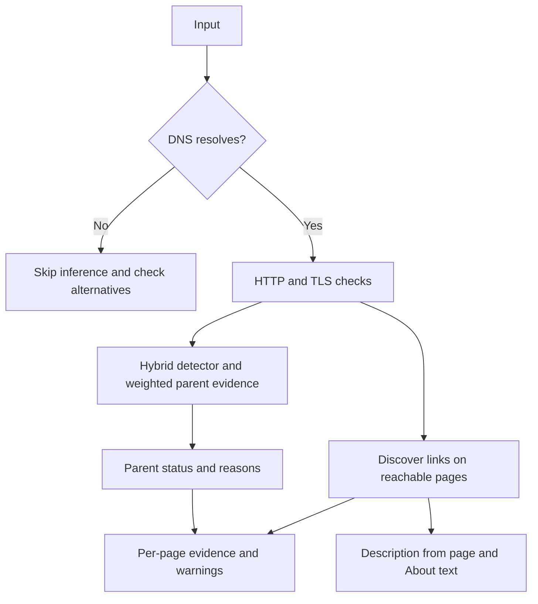

# PhishGuard AI - Explainable Phishing Risk Checker

Paste a web address and PhishGuard tells you whether it looks like phishing, **why**, and **which part of the address you would really be visiting**. It combines a transparent rule engine with a machine-learning ensemble, and it reports honest accuracy numbers measured on data the model never saw.

## What it does

- **Two detectors, one verdict.** 16 auditable rules plus a gradient-boosting model (41 URL features) blended with a character n-gram model. Final score = 80% model + 20% rules, with a critical-rule floor and a trusted-brand-domain cap. Verdicts: *Likely safe* (< 35), *Suspicious* (35-64), *High risk* (65+).
- **Explains itself.** Every verdict lists the rules that fired, the features that pushed the model's score up or down, and a URL anatomy strip that highlights the registered domain, `@` disguises and brand-in-subdomain tricks.
- **Honest evaluation.** The benchmark tab shows precision, recall, F1, false-alarm rate (with 95% confidence intervals), confusion matrices, error rates per data source, and real mistakes with root causes, on two test sets: held-out *domains* and *older phishing campaigns*.
- **Optional live-page inspection** in an SSRF-hardened sandbox (see Security).
- **Domain existence before prediction.** DNS A/AAAA/CNAME/NS lookup runs first, followed by a bounded HTTPS/HTTP reachability check. Names that do not resolve are reported as unresolved and are not sent to the phishing model.
- **Evidence-ranked alternatives.** For unresolved names and likely typos, the app tries common suffix and look-alike candidates. A suggestion is shown as verified only when it resolves, serves HTTPS with a valid certificate, appears in the configured local Tranco list, and has no too-recent WHOIS age when WHOIS returns one. These signals are evidence, not proof.
- **Subpage verification.** For reachable parents, the app checks up to 30 depth-one internal links, prioritizes account/payment/help pages, honors robots.txt, and labels external services (including payment gateways) as Third-party.
- **Extractive page description.** A category and short page-derived summary use metadata, headings, and visible text. Unreachable pages are described as unavailable; no LLM key is needed.

## Results (held-out test, 996 links)

| Detector | F1 | Precision | Recall | False-alarm rate |
| --- | --- | --- | --- | --- |
| Rule engine | 0.66 | 0.69 | 0.63 | 29.5% |
| ML ensemble | 0.96 | 0.97 | 0.96 | 3.3% |
| Hybrid (shown in app) | 0.96 | 0.96 | 0.96 | 4.5% |

On older campaigns the hybrid scores F1 0.97. See the *How well it works* tab or `evaluation/evaluation_results.json` for everything, including the limitations below.

## What changed in v2

| Area | Before | Now |
| --- | --- | --- |
| Data | ~1,550 template-generated URLs labelled as PhishTank/Tranco; model scored 100% (meaningless) | ~6,500 URLs: real phishing from Phishing.Database, real long-tail benign URLs, plus curated benign; splits grouped by registered domain; separate older-campaign test |
| Bias controls | none | per-host / per-domain / per-platform caps; scheme and "has path" decorrelated from the label |
| Features | 21 | 41 (public-suffix aware, token-based brand matching, typosquat/homoglyph, embedded URLs, entropy, ...) |
| Model | Random Forest | Gradient boosting + character n-gram model, calibrated on validation data |
| Rules | 11 | 16, thresholds tuned on validation data |
| Page sandbox | literal-IP check only | DNS-resolution check on every hop, manual redirect validation, scheme allow-list |
| API | single endpoint | input validation, `/api/batch`, `/api/health`, error handling |
| UI | dark SOC dashboard, out of sync with the model | rebuilt light/dark-aware "evidence report" UI with URL anatomy, accessible tabs, mobile layout |
| Tests | 7 | 30 (API, detection quality, SSRF, DNS suggestions, subpages and page descriptions) |

## Limitations (please read)

- The legitimate side of the corpus is partly synthetic (well-known domains with generated paths) and partly an older public corpus, so false-positive rates on today's real traffic may be higher than reported.
- URL-only analysis cannot see page content. Phishing on a compromised legitimate site, or via an open redirect on a trusted domain, can look normal.
- Phishing infrastructure changes quickly. Rebuild the dataset and retrain regularly.

## Project layout

```text
app.py                 FastAPI app, API routes, feature dictionary
run.py                 Starts the server on http://127.0.0.1:8000
train_model.py         Trains models/trained_model.joblib from data/train.csv (calibrated on val.csv)
evaluate_cli.py        Re-runs the benchmark, writes evaluation/evaluation_results.json
data/dataset_builder.py  Downloads feeds into data/cache/ and builds train/val/test/ood_test.csv
features/extractor.py  41 features + URL anatomy
models/                rule_based.py, ml_detector.py, explainer.py (score blending), trained_model.joblib
evaluation/evaluator.py  Metrics, confidence intervals, per-source errors, error mining
analyzer/domain_checker.py DNS/HTTPS existence, SSRF-safe redirects, Tranco/WHOIS evidence and suggestions
analyzer/link_crawler.py  Depth-one robots-aware subpage inspection and page red flags
analyzer/site_describer.py Extractive page description and category
analyzer/page_analyzer.py  Optional isolated page inspection
templates/, static/    UI
tests/test_pipeline.py 20 automated tests
```

## Run it

```bash
pip install -r requirements.txt
python run.py                      # open http://127.0.0.1:8000
```

### Local Tranco list (for verified suggestions)

This repository does not include the Tranco CSV. Put a Tranco export with
`rank,domain` columns at `data/tranco.csv`, or point `TRANCO_CSV_PATH` at the
file. You can also point it directly at the project raw.csv. Only legitimate Tranco rows with a positive rank supply popularity evidence. In Windows PowerShell, run this before starting the app:

```powershell
$env:TRANCO_CSV_PATH = Join-Path $env:USERPROFILE "Downloads/ds/raw.csv"
```

The app does not download a list automatically. Without a matching local
Tranco rank, it will not label an alternative as verified genuine. WHOIS age
is an additional signal when the optional WHOIS lookup returns a creation date.

Every submitted hostname is checked for DNS and basic reachability. Enable the
separate page-sandbox checkbox for the existing additional page inspection.
The submitted page (including its path and query) supplies the description. The report prioritizes sentences explaining what the service offers or lets visitors do. Reachable parents get depth-one subpage discovery.

Illustrative response for a missing domain (a candidate appears only if every
verification check passes; the rank below is a placeholder for your local list):

```text
netgame.edu does not resolve in DNS, so phishing prediction was skipped.
Did you mean https://netgame.com/ (high confidence; Tranco #<rank>)
Reason: Tranco rank, validated HTTPS certificate, and WHOIS age when available.
```

### Request flow

The parent receives 3 points for valid same-domain TLS, 1 for HTTP 2xx, 3 for Tranco membership, 2 for registration age of at least 90 days, 2 for an institutional suffix and 2 for a Likely safe hybrid result. Legitimate requires 7 points, validated TLS, a successful response, Likely safe and no hard negative. IP hosts, invalid certificates, cross-domain redirects, young domains and High risk veto verification. Missing rank or age adds zero. These weights are heuristic.

Reachable unverified parents still get discovery. A direct same-domain HTTPS subpage can inherit legitimacy with medium warnings. High flags and High risk prevent inheritance. Sparse menus trigger bounded sitemap and common-path discovery. Explicit robots exclusions apply even when the parent is verified.

Download a real ranking from [Tranco](https://tranco-list.eu/) and configure the local file path above. The file data/tranco.sample.csv illustrates the format with fictional ranks.



Other commands:

```bash
python -m pytest -q tests          # or: python -m unittest discover -s tests
python evaluate_cli.py             # recompute the benchmark
python data/dataset_builder.py     # re-download feeds and rebuild the splits (~75 MB, needs internet)
python train_model.py              # retrain after rebuilding the data
```

## API

| Method | Path | Purpose |
| --- | --- | --- |
| POST | `/api/analyze` | `{"url": "...", "enable_page_analysis": false}` returns DNS/HTTP evidence, suggestions, description, subpage table, then the existing verdict if DNS resolves |
| POST | `/api/batch` | `{"urls": [...]}` (max 25) returns verdict and score per URL |
| GET | `/api/evaluation` | Stored benchmark |
| POST | `/api/evaluation/recalculate` | Recompute the benchmark from the CSVs |
| GET | `/api/samples` | Demo URLs |
| GET | `/api/features/dictionary` | All 41 features |
| GET | `/api/health` | Status, version, model info |

Interactive docs: `/docs`.

## Security notes

Domain verification and subpage checks make outbound requests to user-entered or derived candidate hosts. Only http/https and standard ports are accepted; every request and redirect is checked against loopback, private, link-local, carrier-grade NAT and reserved ranges before connecting; timeouts and a 512 KB response cap apply; HTTPS certificate validation stays enabled; scripts are never executed. The subpage crawler is depth one, limited to 30 links, and honors fetched robots.txt rules. A DNS-rebinding race between lookup and connect remains theoretically possible, so deploy the service without access to sensitive internal networks. Tranco rank, DNS existence, age and TLS do not guarantee that all content is legitimate. The UI builds dynamic content with `textContent`, so URLs and API responses are never interpreted as HTML.

## Tests

```bash
python -m pytest -q tests
```

The network-related tests mock DNS and HTTP responses. They cover an unresolved
`netgame.edu` with a verified `netgame.com` candidate, typosquat suggestions,
safe and suspicious subpages, external payment gateways, unreachable pages,
and refusal to infer a page description when content is unavailable.

## Reference

Phishing detection through URL-based hybrid machine learning, IEEE Access, 2023.
